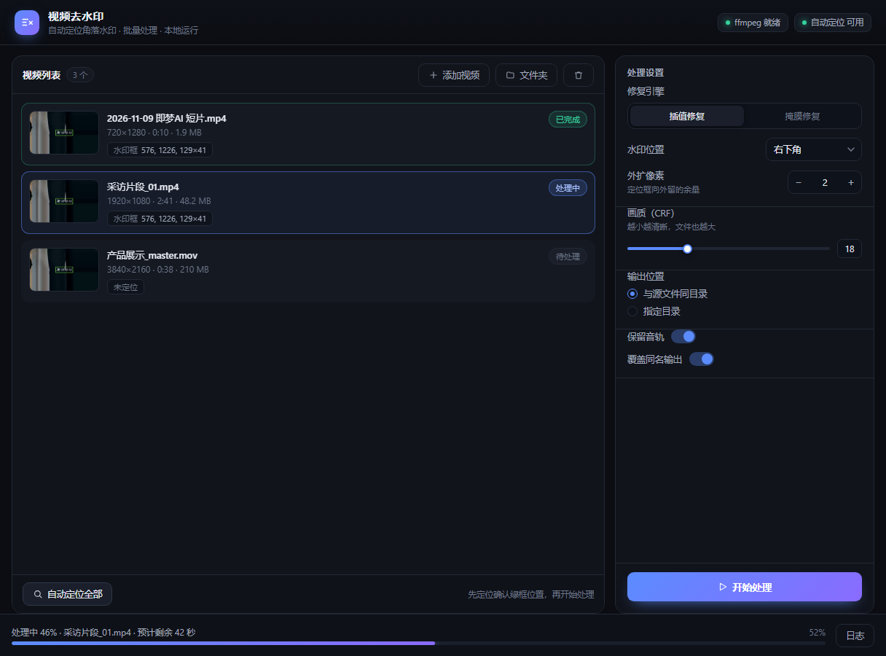

# video-dewatermark · 视频水印批量去除

自动定位视频角落的固位水印（如「即梦AI」「可灵」「剪映」等），批量去除，保留原音频。
提供**图形界面**和**命令行**两种用法，全部在本机运行。



## 📚 分步教程（推荐按顺序阅读）

如果你想理解实现而不只是使用，请从 [docs/00-学习路线与项目总览](docs/00-学习路线与项目总览.md) 开始，共 9 篇，覆盖环境搭建、CLI、FFmpeg 调用、自动定位算法、两种修复引擎、pywebview 架构、前端交互与工程踩坑。每篇末尾都有小练习，可边读边改。

## 一、图形界面（推荐）

双击 **`启动界面.bat`** 即可打开窗口。

操作流程：

1. **添加视频** —— 两种方式：
   - 右上角「添加视频」选文件，或「文件夹」整目录导入（含子目录）；
   - 在资源管理器里 Ctrl+C 复制文件/文件夹，回到窗口按 **Ctrl+V** 导入。
2. **自动定位** —— 点左下「自动定位全部」，每张卡片会显示水印框坐标和一张带绿框的特写缩略图。
   - 点缩略图可放大查看；浮层里能直接改 `x / y / 宽 / 高`，改完点「应用」；也能点「重新定位」重试。
   - 定位结果带**置信度**：低于 50% 时卡片会标成黄色「待确认」，说明算法没把握，请点开缩略图核一下再处理。
3. **调整设置**（右侧）
   - 修复引擎：**插值修复**（默认，快且稳）/ **掩膜修复**（纹理背景更自然，慢一些）
   - 水印位置：右下 / 左下 / 右上 / 左上 / 底部通栏 / 顶部通栏
   - 外扩像素：定位框向外留的余量，默认 2
   - 画质 CRF：14~28，越小越清晰、文件越大（默认 18）
   - 输出位置：与源文件同目录，或指定目录
4. **开始处理** —— 底部显示总进度与预计剩余时间，完成后「打开输出目录」直接跳到结果所在文件夹。

> 「日志」按钮可展开每一步的详细输出（定位坐标、每段耗时、失败原因）。
> 关闭窗口会中断处理，正在写的那个文件不会完整。

## 二、命令行

```bash
# 单文件，自动定位右下角水印
python dewatermark.py video.mp4

# 批量：整个目录 + 子目录，输出到 out/，并发 2 个
python dewatermark.py "D:/素材" -o out --recursive --jobs 2

# 先只定位不处理（生成绿框预览图，确认框准不准）
python dewatermark.py "D:/素材" --dry-run --preview

# 自动定位不准时，手动指定水印框（x,y,w,h 像素）
python dewatermark.py video.mp4 --box 576,1226,129,41
```

拖放版：把文件或文件夹拖到 **`去水印.bat`** 上，输出到该目录下的 `output\`。

### 参数速查

| 参数 | 说明 |
|---|---|
| `-o, --output-dir` | 输出目录，默认与源文件同目录 |
| `--suffix` | 输出文件名后缀，默认 `_dewm` |
| `--mode delogo\|inpaint` | 引擎，默认 `delogo`；`inpaint` 可配 `--inpaint-algo telea\|ns` |
| `--corner br\|bl\|tr\|tl\|bottom\|top` | 水印所在位置，默认 `br` 右下 |
| `--box x,y,w,h` | 手动框，可重复传多个；指定后不再自动定位 |
| `--pad` | 自动定位后向外扩的像素，默认 2 |
| `--crf` / `--preset` | 输出画质，默认 18 / medium |
| `--jobs` | 同时处理几个文件，默认 1 |
| `--recursive` | 目录输入时递归子目录 |
| `--overwrite` | 覆盖已有输出 |
| `--no-audio` | 丢弃音轨 |
| `--dry-run` / `--preview` | 只看不处理 / 生成定位预览图 |

## 三、自动定位原理（说明：不是 AI 模型，是图像统计）

1. 均匀抽取约 32 帧，取**时间中值帧** —— 移动的人物、镜头晃动会被中值抹掉，静止叠加的水印留下；
2. 对中值帧做高通，水印笔画是局部窄边，响应明显强于平滑背景；
3. 把强响应的连通域按「同一行、高度相近、能量相当」聚类成一行文字（图标 + 字）；
4. **每个强响应块都当作一次候选**，聚成一行文字后做带能量验证的横向补全（只为补上压在亮背景上的弱笔画），
   最后按「角落先验 + 对比强度 + 横向长条形态」综合打分，取最高分的那个框；
   —— 这一步很关键：背景里的亮边、桌沿往往比小号水印"更强"，只看强度必然选错位置；
5. 输出置信度，低于阈值时界面标黄提示人工确认，命令行会打印告警并退回保守的角落框。

它擅长：位置固定、笔画清晰的角标（即梦AI、可灵、剪映这类）。
它不擅长：会动的水印、铺满全屏的平铺水印、和背景颜色几乎一样的低对比水印 —— 这些情况请用缩略图手动框一下。

## 四、画质说明

- 水印区域是**插值重建**，不是"恢复原图"。logo 压在大面积平坦区域（天空、纯色衣物、墙面）时几乎无痕；
  压在细密纹理或强边缘上时，放大看会有轻微涂抹感 —— 这是所有去水印算法的共性。
- 想痕迹更小：定位框越贴合水印越好（界面里点缩略图微调），并用更小的 CRF（如 16）。
- 引擎对比（同一素材放大 4 倍目视）：`delogo` 最干净、速度最快，作为默认；
  `inpaint` 在纹理背景上有时更自然，但遇到强结构边缘（细线、栏杆）容易拖出色块，建议两种都试一次取好的。

## 五、环境依赖

- **ffmpeg（含 ffprobe）**：脚本会自动在 PATH、winget 安装目录、imageio-ffmpeg 中查找；也可用环境变量 `FFMPEG_PATH` 指定。
- **Python 3.9+**，依赖安装：

```bash
pip install -r requirements.txt
```

内含 `numpy`、`opencv-python`、`pywebview`。缺 opencv 时命令行仍可用（`--box` 手动定位），但界面自动定位不可用；
图形界面依赖 Windows 自带的 WebView2 运行时（Win10/11 默认已安装）。

## 六、文件说明

| 文件 | 作用 |
|---|---|
| `启动界面.bat` | 双击打开图形界面 |
| `app.py` | 图形界面后端（pywebview + JS bridge） |
| `ui/index.html` | 图形界面（单文件 HTML/CSS/JS；用浏览器直接打开会进入演示模式） |
| `dewatermark.py` | 去水印引擎 + 命令行入口 |
| `去水印.bat` | 命令行拖放入口 |

## 七、关于文件拖放

当前版本**不支持**把文件从资源管理器拖进窗口：程序跑在 WebView2 里，Windows 的 OLE 拖放通道
在部分环境（含本机）无法把真实文件路径传给页面，做成"能拖但没反应"反而更误导，所以界面上不做这个承诺。

导入请用「添加视频」/「文件夹」按钮，或在资源管理器复制文件后回到窗口 **Ctrl+V**。
